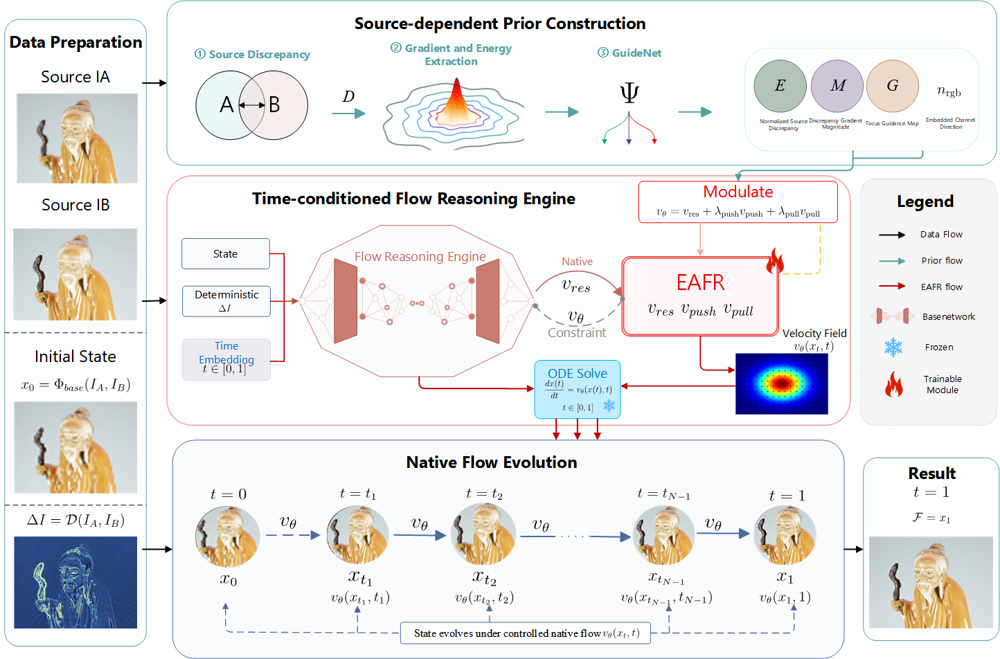

<h1 align="center">PE-AFR</h1>

<p align="center">
  <b>Physics-guided Energy Adaptive Flow Regularization for Multi-focus Image Fusion</b>
</p>

<p align="center">
  <a href="https://yyz0703.github.io/PE-AFR/">Interactive Demo</a> |
  <a href="#network-architecture">Network Architecture</a> |
  <a href="#fusion-results">Fusion Results</a>
</p>

<p align="center">
  
  
  
</p>

---

## Introduction
PE-AFR** is a multi-focus image fusion framework that combines a learned residual velocity with explicit Push and Pull guidance during flow evolution.

- **Residual flow:** learns the evolution from an initial source-image average toward a fused image.
- **Push and Pull guidance:** modulates the velocity field using source-derived information and a channel-space direction mapping.
- **GuideNet:** estimates source-image focus preferences to guide fusion.

The manuscript is currently under review. This repository provides the model architecture code, fusion results, and an interactive visual demonstration.

## Network Architecture

<p align="center">
  
</p>
<p align="center"><b>Figure 1.</b> Overview of the PE-AFR framework.</p>


## Interactive Visual Demonstration

### [Open the Interactive Demo](https://yyz0703.github.io/PE-AFR/)

The browser-based interface offers a **visual demonstration** of the evaluation workflow using three representative examples with aligned all-in-focus references and four precomputed outputs: **Direct Regression, Flow Baseline, PE-AFR, and PE-AFR with mild smoothing**.

- **Inspect images:** switch between full images and enlarged regions to examine boundaries and fine details.
- **Explore ranking:** assess boundary-transition fidelity, halo quality, and texture preservation, with configuration names hidden during ranking and ties permitted.
- **Export judgments:** save rankings as CSV or JSON files locally.

This demonstration provides a convenient visual reference for the evaluation procedure. Demonstration judgments are separate from the formal study reported in the manuscript.

For local viewing, open `docs/index.html` in a browser. The demonstration runs without Python.

## Repository Structure

```text
PE-AFR/
├── README.md
├── models/
│   └── models.py
├── results/
│   ├── Lytro/
│   ├── MFFW/
│   ├── MFI-WHU/
│   └── Grayscale/
└── docs/
    ├── index.html
    ├── app.js
    ├── style.css
    ├── data.js
    └── assets/
        ├── figure1.png
        └── ...
```

- [Model architecture](./models/): network implementation.
- [Fusion results](./results/): outputs organized by dataset.
- [Demo source files](./docs/): HTML interface, scripts, and example images.

## Environment

- **Python:** 3.9.
- **Framework:** PyTorch.
- **Image operations:** torchvision.

## Fusion Results

The `results/` directory stores PE-AFR fusion outputs in separate dataset folders:

| Folder | Contents |
| --- | --- |
| `results/Lytro/` | Fusion outputs for the Lytro dataset. |
| `results/MFFW/` | Fusion outputs for the MFFW dataset. |
| `results/MFI-WHU/` | Fusion outputs for the MFI-WHU dataset. |
| `results/Grayscale/` | Fusion outputs for the grayscale dataset. |

Each image represents the fused output of one source-image pair. Match outputs to their source pairs by sample identifier rather than file order. The images under `docs/assets/` are used by the interactive demonstration; the dataset results are stored under `results/`.


## Release Plan

- [x] Release the model architecture code.
- [x] Provide fusion results.
- [x] Provide the interactive visual demonstration interface.
- [ ] Release pretrained weights and inference code upon acceptance.
- [ ] Release the complete training code, preprocessing scripts, and experimental evaluation code upon acceptance.

The complete code and pretrained weights will be made publicly available upon acceptance.
